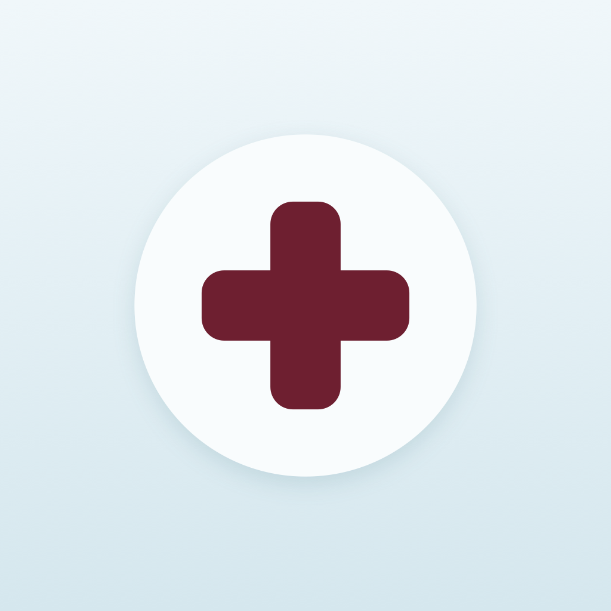
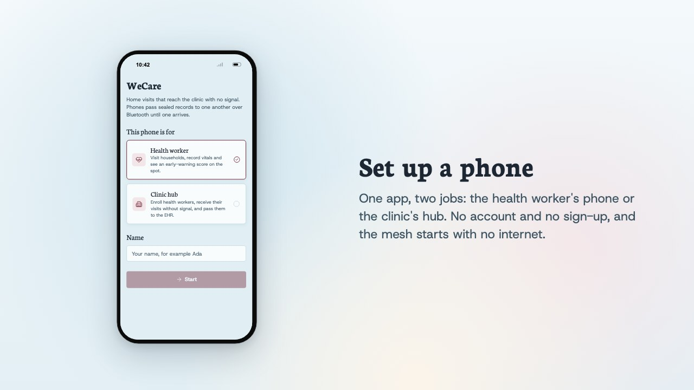
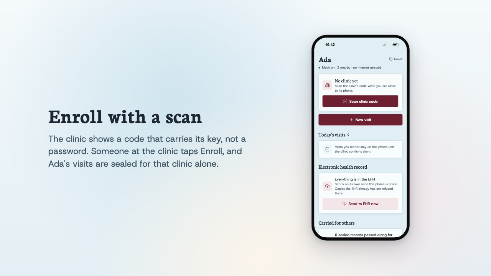
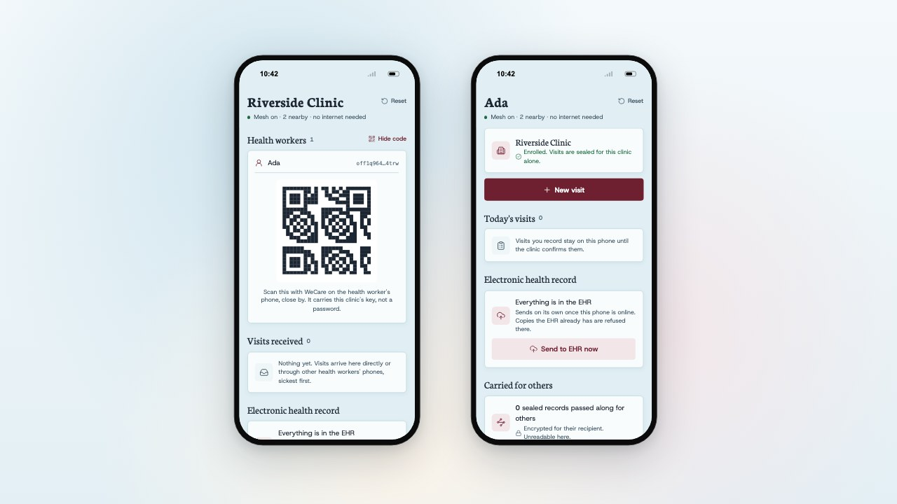
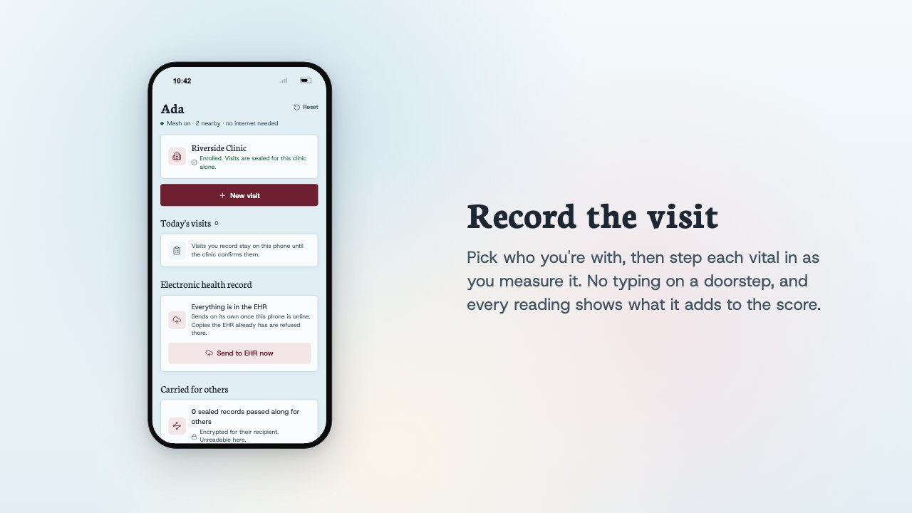
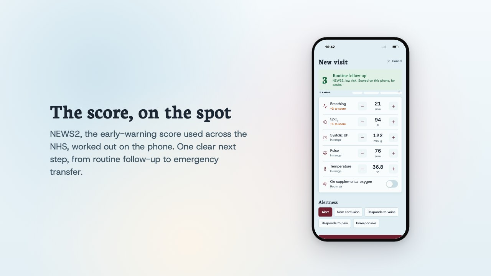
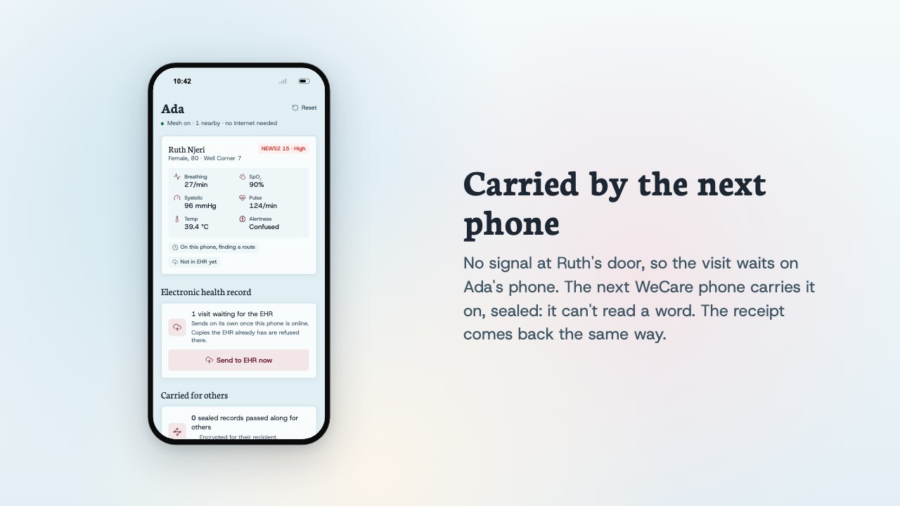
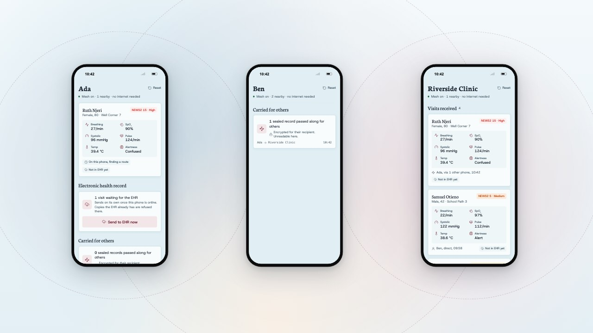
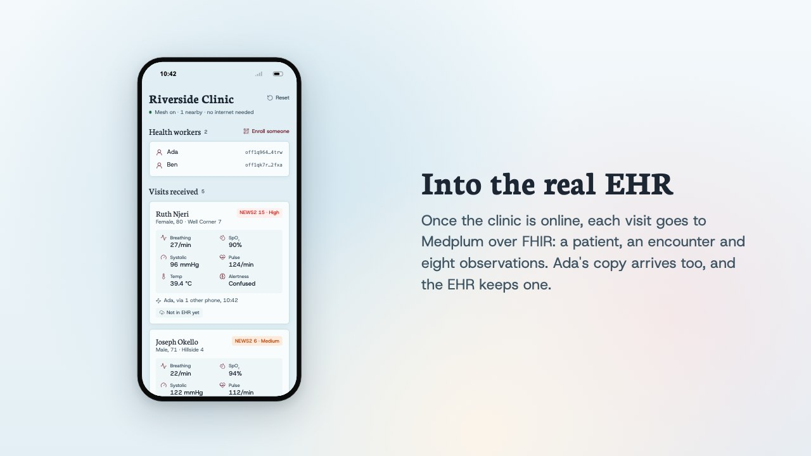
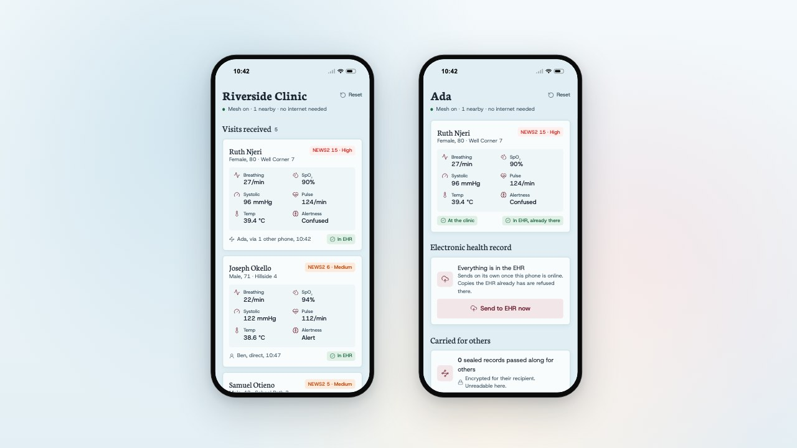

<p align="center"></p>

# WeCare

WeCare is a mobile app for community health workers who visit patients at
home, often where there is no signal. They record a visit on their phone, see
at once how sick the patient is, and the visit reaches the clinic on its own:
over Bluetooth, end-to-end encrypted, hopping through other health workers'
phones if it has to. When any phone holding it gets online, the visit lands in
the clinic's EHR. It's built on the
[Offline Protocol SDK](https://www.npmjs.com/package/@offline-protocol/mesh-sdk).

React Native 0.88, `@offline-protocol/mesh-sdk` 0.31, Medplum. Every patient
and health worker is synthetic.

## What it is

Community health workers visit households far from the clinic. Where there is
no mobile signal, a visit usually means paper, a late report, and a patient who
is getting worse without anyone at the clinic knowing. WeCare closes that gap
with phones alone: no towers, no Wi-Fi, no server in the field.

One app, two roles:

- **Health worker.** Records a visit (patient, vitals, alertness), sees an
  early-warning score and a next step at once, and saves it. The visit leaves
  for the clinic on its own.
- **Clinic hub.** A phone at the clinic. It enrolls health workers, receives
  their visits sickest first, and passes them to the clinic's EHR.

Any phone running WeCare also carries sealed visits for others, so a health
worker walking between a colleague and the clinic becomes part of the route.

## How it works

```
 Health worker's phone            other WeCare phones           Clinic hub phone              EHR
 (no signal)                      (carry it, can't read it)     (online when it can be)
 record visit, score NEWS2  -->   Bluetooth mesh, any hops  -->  re-score, triage      -->    Medplum, FHIR R4
                            <--   receipt, same way back    <--
```

1. **Enroll once, by QR.** The clinic hub shows a code that carries its
   address and public key. The health worker scans it near the clinic, and
   staff tap **Enroll**. From then on the two phones share an end-to-end
   encrypted session.
2. **Record offline.** The health worker picks the patient and steps in the
   vitals. The phone computes NEWS2 (Royal College of Physicians, 2017) and
   shows the next step, from *Routine follow-up* to *Emergency transfer*. The
   visit is saved on the phone first.
3. **Carry it home.** The visit goes to the clinic as one encrypted 1:1
   message over Bluetooth. If the clinic is out of range, the mesh hands it to
   nearby WeCare phones, which forward it without being able to read it. The
   health worker's phone resends every 30 seconds until the clinic's receipt
   comes back.
4. **Triage at the clinic.** The hub accepts visits only from phones it
   enrolled, validates every field, recomputes the score itself instead of
   trusting the sender's, and lists visits sickest first.
5. **Into the EHR.** Whichever phone holding a visit gets internet first (the
   hub or the health worker's) writes it to the EHR. The server keeps exactly
   one copy, however many phones send it.

## Offline Protocol SDK integration

Everything between phones goes through the SDK; the app never touches
Bluetooth itself. All of it lives in `src/mesh.ts`.

| Need | SDK |
|------|-----|
| A mesh with no infrastructure | `ProtocolConfig` with only the `ble` transport enabled (internet, Wi-Fi Direct, Nostr and Reticulum off) |
| Every phone helps carry records | `relay: { allowRelay: true, relayPriority: 'always' }`, so a phone relays whatever its battery |
| Identity and encryption | `initializeMlsWithSecureStorage()`, `localAddress()`, and `encryption: { enabled, autoKeyExchange, storePending }` |
| Enrollment by QR | `createInvite()` on the hub; `parseInvite()` on the health worker's phone, which rejects a code whose address doesn't derive from its key |
| Clinic approval | `sendConnectionRequest()`, the `connection_request_received` event, then `acceptConnectionRequest()` or `rejectConnectionRequest()`, and `connection_accepted` |
| Sending a visit and its receipt | `sendMessage()` for an MLS-encrypted 1:1 message; `message_received` with `hop_count`, shown at the clinic as *direct* or *via N other phones* |
| Store and forward | the SDK queues and retries undelivered messages and hands them to neighbors when the recipient is out of reach; the app adds its own receipt and resend on top, so "at the clinic" means the clinic confirmed it |
| Showing the relay | `message_relayed` drives *Carried for others*: sender, recipient and hop count only, never content |
| Who is around | `neighbor_discovered` and `neighbor_lost` drive "Mesh on · N nearby · no internet needed" |

Trust is kept at the edges: the clinic drops anything from a phone it didn't
enroll, `parseWire` validates every message as untrusted input, and logs never
contain message content.

## EHR integration

The EHR is [Medplum](https://www.medplum.com), an open-source, FHIR-native EHR
platform, self-hosted for the demo from its published Docker images
(`medplum/docker-compose.yml`). The code is `src/domain/fhir.ts` and
`src/services/medplum.ts`.

- **FHIR R4 transaction per visit.** One bundle holds a **Patient**, an
  **Encounter** (class *home health*, the health worker as participant) and
  eight **Observations**: respiratory rate, oxygen saturation, systolic blood
  pressure, heart rate and body temperature with their LOINC codes, plus
  supplemental oxygen, level of consciousness (ACVPU) and the NEWS2 total.
- **Idempotent by design.** Every resource is a conditional create
  (`ifNoneExist`) on a stable identifier (`urn:wecare:patient`,
  `urn:wecare:visit`, `urn:wecare:observation`). The server, not the phone,
  decides whether a visit is new: *201* means added, *200* means it was
  already there. That is what lets several phones sync the same visit safely.
- **The EHR stays the record of authority.** Phones only ever create; they
  never update or delete. Offline capture can't conflict with the chart: at
  worst a phone offers a visit the EHR already has, and the conditional create
  turns it into a no-op.
- **Sign-in.** OAuth 2.0 client credentials against Medplum, with the token
  cached and renewed early. Sync runs on its own every 15 seconds while visits
  are pending, or on **Send to EHR now**.
- **Demo shortcut.** The client secret is compiled into the app. A real
  deployment would keep it server-side, behind a small gateway the phones call.

## Features demoed

- **Phone setup with no account:** pick a role, type a name, and the mesh
  starts with no internet.
- **QR enrollment with clinic approval:** the code carries a key, not a
  password, and someone at the clinic taps **Enroll**.
- **Offline visit capture:** the patient roster, vitals steppers, quick
  presets, and each reading's contribution to the score.
- **On-device NEWS2:** the score and the next step update as each vital
  changes.
- **Multi-hop sealed relay:** a visit reaches the clinic *via 1 other phone*,
  which shows it carried a record it couldn't read, and the receipt returns
  the same way.
- **Clinic triage:** visits sorted by risk, re-scored at the clinic, accepted
  only from enrolled phones.
- **EHR sync with deduplication:** the clinic's copy lands in Medplum as a
  Patient, an Encounter and eight Observations; the health worker's later copy
  comes back *In EHR, already there*.

## A walk through it

Stills from the launch video (`video/`, built in Remotion from the app's own
screens). The patients and health workers are the app's synthetic demo data.










